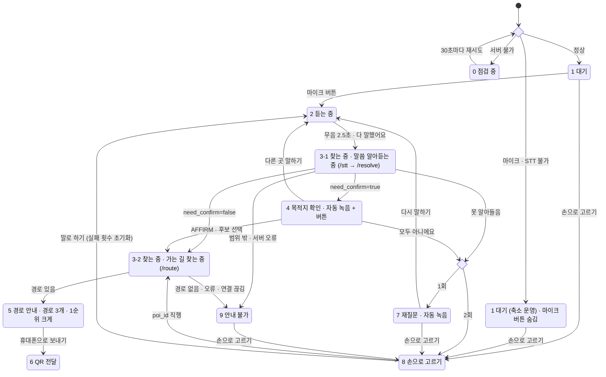

# 키오스크 상태 다이어그램 (Mermaid)

원본: `docs/workflow.png` 를 Mermaid `stateDiagram-v2` 문법으로 옮긴 것입니다.
상태 이름은 영어 대문자 스네이크 케이스이고, 원래 한글 이름은 각 상태 위의 `%%` 주석과
`상태 : 설명` 라벨에 남겨 두었습니다. 마름모(판단 분기)는 `<<choice>>` 로 표현했습니다.

## 상태 이름 대응표

| 영어 상태 | 원래 한글 이름 | 비고 |
|---|---|---|
| `STARTUP_CHECK` | 시작 점검 (/health + 마이크) | 마름모 판단 노드 → `<<choice>>` |
| `CHECKING` | 0 점검 중 | |
| `IDLE` | 1 대기 | |
| `IDLE_REDUCED` | 1 대기 (축소 운영) · 마이크 버튼 숨김 | |
| `LISTENING` | 2 듣는 중 | |
| `RESOLVING` | 3-1 찾는 중 · 말씀 알아듣는 중 | `/stt → /resolve` |
| `CONFIRMING` | 4 목적지 확인 · 자동 녹음 + 버튼 | |
| `FAIL_COUNT_CHECK` | 실패 횟수 | 마름모 판단 노드 → `<<choice>>` |
| `ROUTING` | 3-2 찾는 중 · 가는 길 찾는 중 | `/route` |
| `REASKING` | 7 재질문 · 자동 녹음 | |
| `UNAVAILABLE` | 9 안내 불가 | |
| `MANUAL_SELECT` | 8 손으로 고르기 | |
| `ROUTE_GUIDE` | 5 경로 안내 · 경로 3개 · 1순위 크게 | |
| `QR_HANDOFF` | 6 QR 전달 | |

## 확인 필요

이미지에서 확실히 읽히지 않았거나, 다이어그램에 없어서 추측하지 않고 남겨 둔 항목입니다.

1. **`CHECKING → STARTUP_CHECK` (30초마다 재시도)** 는 원본에서 점선입니다. Mermaid stateDiagram은 점선 전이를 지원하지 않아 실선으로 옮겼습니다. 점선이 "자동 재시도"라는 뜻 외에 다른 의미(예: 비동기, 백그라운드)가 있는지 확인이 필요합니다.
2. **`RESOLVING → UNAVAILABLE` (범위 밖 · 서버 오류)** 선은 `CONFIRMING` 박스 옆을 지나가서 출발점이 3-1인지 4인지 다소 헷갈립니다. 선의 시작 위치상 3-1(말씀 알아듣는 중)에서 출발하는 것으로 옮겼습니다.
3. **라벨에 쓰인 `·` 의 의미**: `무음 2.5초 · 다 말했어요`, `AFFIRM · 후보 선택`, `경로 없음 · 오류 · 연결 끊김`, `마이크 · STT 불가` 등은 "둘 중 하나라도 발생하면"(OR)으로 해석했습니다. AND 조건인 곳이 있으면 알려 주세요.
4. **`마이크 · STT 불가` 판단 시점**: 시작 점검에서 "서버 불가"와 "마이크 · STT 불가"가 동시에 해당할 때 어느 쪽이 우선인지 다이어그램에 없습니다.
5. **`IDLE_REDUCED` (축소 운영) 복구 경로 없음**: 축소 운영 상태에서 마이크/STT가 다시 정상이 됐을 때 `IDLE`로 돌아가는 화살표가 없습니다. 재점검 주기가 있는지 확인이 필요합니다.
6. **`LISTENING` 의 탈출 조건 부족**: 사용자가 아무 말도 하지 않을 때의 타임아웃, 취소 버튼 등 `무음 2.5초 · 다 말했어요` 외의 탈출 전이가 없습니다. "무음 2.5초"가 "말한 뒤 2.5초 무음"인지 "처음부터 2.5초 무음"인지도 확인이 필요합니다.
7. **실패 횟수 초기화 시점**: 초기화는 `MANUAL_SELECT → LISTENING (말로 하기)` 에서만 명시되어 있습니다. `ROUTE_GUIDE` 도달 시, `IDLE` 복귀 시 등 다른 초기화 시점이 있는지 확인이 필요합니다. 또 "1회 / 2회"가 누적 실패 횟수를 뜻하는지(1회 = 첫 실패, 2회 = 두 번째 실패)도 확인 부탁드립니다.
8. **종료 상태 및 `IDLE` 복귀 경로 없음**: `ROUTE_GUIDE`, `QR_HANDOFF`, `UNAVAILABLE`, `MANUAL_SELECT` 에서 `IDLE` 로 돌아가는 전이(처음으로 버튼, 일정 시간 미조작 타임아웃 등)가 다이어그램에 없습니다. 실제 키오스크 운영에는 필요할 것으로 보입니다.
9. **`ROUTE_GUIDE → QR_HANDOFF` 외의 선택지**: 경로 3개 중 다른 경로를 고르는 동작, 휴대폰으로 보내지 않고 끝내는 동작은 다이어그램에 없습니다.
10. **`CONFIRMING` 의 "자동 녹음" 결과 처리**: 자동 녹음된 음성이 다시 `/stt → /resolve` 를 거치는지(즉 `CONFIRMING → RESOLVING` 전이가 있는지), 아니면 AFFIRM/부정만 판별하는지 다이어그램만으로는 알 수 없습니다. `REASKING` 의 "자동 녹음"도 `LISTENING` 을 거치는 것으로 그려져 있어 그대로 옮겼습니다.
