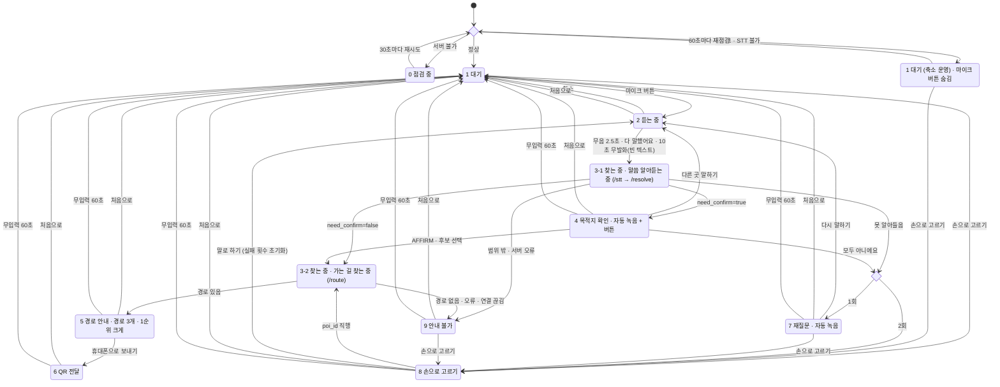

# 키오스크 상태 다이어그램 (Mermaid)

원본: `docs/workflow.png` 를 Mermaid `stateDiagram-v2` 문법으로 옮긴 것입니다.
상태 이름은 영어 대문자 스네이크 케이스이고, 원래 한글 이름은 각 상태 위의 `%%` 주석과
`상태 : 설명` 라벨에 남겨 두었습니다. 마름모(판단 분기)는 `<<choice>>` 로 표현했습니다.

> 2026-11-09 팀 회의 확정분: `IDLE_REDUCED → STARTUP_CHECK` (재점검), `LISTENING → IDLE` (취소), `LISTENING → RESOLVING` 라벨에 10초 무발화 추가, '처음으로' 7건, '무입력 60초' 6건(회의 후 `CONFIRMING`, `REASKING` 2건 추가: 사용자가 그 화면에서 자리를 떠나면 키오스크가 멈추기 때문). `IDLE` 로 들어갈 때(취소·처음으로·무입력) 실패 횟수는 0으로 초기화한다.

## 상태 이름 대응표

| 영어 상태 | 원래 한글 이름 | 비고 |
|---|---|---|
| `STARTUP_CHECK` | 시작 점검 (/health + 마이크) | 마름모 판단 노드 → `<<choice>>` |
| `CHECKING` | 0 점검 중 | |
| `IDLE` | 1 대기 | |
| `IDLE_REDUCED` | 1 대기 (축소 운영) · 마이크 버튼 숨김 | |
| `LISTENING` | 2 듣는 중 | |
| `RESOLVING` | 3-1 찾는 중 · 말씀 알아듣는 중 | `/stt → /resolve` |
| `CONFIRMING` | 4 목적지 확인 · 자동 녹음 + 버튼 | |
| `FAIL_COUNT_CHECK` | 실패 횟수 | 마름모 판단 노드 → `<<choice>>` |
| `ROUTING` | 3-2 찾는 중 · 가는 길 찾는 중 | `/route` |
| `REASKING` | 7 재질문 · 자동 녹음 | |
| `UNAVAILABLE` | 9 안내 불가 | |
| `MANUAL_SELECT` | 8 손으로 고르기 | |
| `ROUTE_GUIDE` | 5 경로 안내 · 경로 3개 · 1순위 크게 | |
| `QR_HANDOFF` | 6 QR 전달 | |

## 확인 필요

이미지에서 확실히 읽히지 않았거나, 다이어그램에 없어서 추측하지 않고 남겨 둔 항목입니다.

> 2026-11-09 팀 회의에서 2·5·6·7·8·10번이 확정되어 위 다이어그램과 아래 표에 반영했습니다. 결정 내용은 `docs/frontend-plan.md` 6절을 참고하세요. 1·3·4·9번은 아직 미확정입니다.

1. **`CHECKING → STARTUP_CHECK` (30초마다 재시도)** 는 원본에서 점선입니다. Mermaid stateDiagram은 점선 전이를 지원하지 않아 실선으로 옮겼습니다. 점선이 "자동 재시도"라는 뜻 외에 다른 의미(예: 비동기, 백그라운드)가 있는지 확인이 필요합니다.
2. **`RESOLVING → UNAVAILABLE` (범위 밖 · 서버 오류)** 선은 `CONFIRMING` 박스 옆을 지나가서 출발점이 3-1인지 4인지 다소 헷갈립니다. 선의 시작 위치상 3-1(말씀 알아듣는 중)에서 출발하는 것으로 옮겼습니다.
3. **라벨에 쓰인 `·` 의 의미**: `무음 2.5초 · 다 말했어요`, `AFFIRM · 후보 선택`, `경로 없음 · 오류 · 연결 끊김`, `마이크 · STT 불가` 등은 "둘 중 하나라도 발생하면"(OR)으로 해석했습니다. AND 조건인 곳이 있으면 알려 주세요.
4. **`마이크 · STT 불가` 판단 시점**: 시작 점검에서 "서버 불가"와 "마이크 · STT 불가"가 동시에 해당할 때 어느 쪽이 우선인지 다이어그램에 없습니다.
5. **`IDLE_REDUCED` (축소 운영) 복구 경로 없음**: 축소 운영 상태에서 마이크/STT가 다시 정상이 됐을 때 `IDLE`로 돌아가는 화살표가 없습니다. 재점검 주기가 있는지 확인이 필요합니다.
6. **`LISTENING` 의 탈출 조건 부족**: 사용자가 아무 말도 하지 않을 때의 타임아웃, 취소 버튼 등 `무음 2.5초 · 다 말했어요` 외의 탈출 전이가 없습니다. "무음 2.5초"가 "말한 뒤 2.5초 무음"인지 "처음부터 2.5초 무음"인지도 확인이 필요합니다.
7. **실패 횟수 초기화 시점**: 초기화는 `MANUAL_SELECT → LISTENING (말로 하기)` 에서만 명시되어 있습니다. `ROUTE_GUIDE` 도달 시, `IDLE` 복귀 시 등 다른 초기화 시점이 있는지 확인이 필요합니다. 또 "1회 / 2회"가 누적 실패 횟수를 뜻하는지(1회 = 첫 실패, 2회 = 두 번째 실패)도 확인 부탁드립니다.
8. **종료 상태 및 `IDLE` 복귀 경로 없음**: `ROUTE_GUIDE`, `QR_HANDOFF`, `UNAVAILABLE`, `MANUAL_SELECT` 에서 `IDLE` 로 돌아가는 전이(처음으로 버튼, 일정 시간 미조작 타임아웃 등)가 다이어그램에 없습니다. 실제 키오스크 운영에는 필요할 것으로 보입니다.
9. **`ROUTE_GUIDE → QR_HANDOFF` 외의 선택지**: 경로 3개 중 다른 경로를 고르는 동작, 휴대폰으로 보내지 않고 끝내는 동작은 다이어그램에 없습니다.
10. **`CONFIRMING` 의 "자동 녹음" 결과 처리**: 자동 녹음된 음성이 다시 `/stt → /resolve` 를 거치는지(즉 `CONFIRMING → RESOLVING` 전이가 있는지), 아니면 AFFIRM/부정만 판별하는지 다이어그램만으로는 알 수 없습니다. `REASKING` 의 "자동 녹음"도 `LISTENING` 을 거치는 것으로 그려져 있어 그대로 옮겼습니다.

## 상태 전이 표

위 Mermaid 다이어그램의 화살표 하나가 표의 한 행입니다(총 41행 = 원본 26행 + 2026-11-09 회의 추가 15행). 이벤트 이름은 영어 대문자 스네이크 케이스이며,
`STARTUP_CHECK`·`FAIL_COUNT_CHECK` 는 마름모 판단 노드(`<<choice>>`)라서 "현재 상태" 열에 나와도 실제 화면 상태는 아닙니다.
API 열은 다이어그램에 적힌 엔드포인트(`/health`, `/stt`, `/resolve`, `/route`)만 사용했고, 서버가 필요한지 다이어그램만으로 알 수 없는 경우는 '미정'으로 적었습니다.

| 현재 상태 | 이벤트 | 다음 상태 | 필요한 API 호출 | 비고 |
|---|---|---|---|---|
| `[*]` (앱 시작) | `APP_START` | `STARTUP_CHECK` | `/health` | 시작 점검 진입 시 서버 상태 + 마이크 확인 |
| `STARTUP_CHECK` | `HEALTH_SERVER_DOWN` | `CHECKING` | - | `/health` 응답 "서버 불가"에 따른 분기 |
| `CHECKING` | `HEALTH_RETRY_TIMER` | `STARTUP_CHECK` | `/health` | 30초마다 재시도 (원본 점선) |
| `STARTUP_CHECK` | `HEALTH_OK` | `IDLE` | - | `/health` 정상 + 마이크 정상 |
| `STARTUP_CHECK` | `MIC_OR_STT_UNAVAILABLE` | `IDLE_REDUCED` | - | 마이크 또는 STT 불가 → 축소 운영, 마이크 버튼 숨김 |
| `IDLE` | `MIC_BUTTON_PRESSED` | `LISTENING` | - | 녹음 시작 |
| `IDLE` | `MANUAL_SELECT_PRESSED` | `MANUAL_SELECT` | 미정 | 목적지 목록을 서버에서 받는지 다이어그램에 없음 |
| `IDLE_REDUCED` | `MANUAL_SELECT_PRESSED` | `MANUAL_SELECT` | 미정 | 축소 운영에서는 손으로 고르기만 가능 |
| `IDLE_REDUCED` | `RECHECK_TIMER` | `STARTUP_CHECK` | `/health` | 60초마다 재점검 (회의 확정). 시간은 설정값 |
| `LISTENING` | `SPEECH_END` | `RESOLVING` | `/stt` → `/resolve` | 발화 후 무음 2.5초, '다 말했어요' 버튼, 또는 진입 후 10초 무발화(빈 텍스트로 전송 → 못 알아들음 처리) |
| `LISTENING` | `LISTEN_CANCEL` | `IDLE` | - | '취소' 버튼 (회의 확정). 실패 횟수 0으로 초기화 |
| `LISTENING` | `GO_HOME` | `IDLE` | - | '처음으로' 버튼 (회의 확정). 실패 횟수 0으로 초기화 |
| `RESOLVING` | `RESOLVE_NEED_CONFIRM` | `CONFIRMING` | - | `/resolve` 응답 `need_confirm=true` |
| `RESOLVING` | `RESOLVE_CONFIRMED` | `ROUTING` | `/route` | `/resolve` 응답 `need_confirm=false` |
| `RESOLVING` | `RESOLVE_NOT_UNDERSTOOD` | `FAIL_COUNT_CHECK` | - | 못 알아들음 → 실패 횟수 +1 |
| `RESOLVING` | `RESOLVE_OUT_OF_SCOPE_OR_ERROR` | `UNAVAILABLE` | - | 범위 밖 또는 서버 오류 (출발점 3-1 = RESOLVING 으로 회의 확정) |
| `CONFIRMING` | `DESTINATION_CONFIRMED` | `ROUTING` | `/route` | AFFIRM 또는 후보 선택. 버튼으로만 진행, 자동 녹음 없음 (회의 확정) |
| `CONFIRMING` | `CONFIRM_NONE_OF_THEM` | `FAIL_COUNT_CHECK` | - | '모두 아니에요' → 실패 횟수 +1 |
| `CONFIRMING` | `CONFIRM_SAY_OTHER_PLACE` | `LISTENING` | - | '다른 곳 말하기' |
| `CONFIRMING` | `GO_HOME` | `IDLE` | - | '처음으로' 버튼. 실패 횟수 0으로 초기화 |
| `CONFIRMING` | `INACTIVITY_TIMEOUT` | `IDLE` | - | 무입력 60초. 사용자가 자리를 떠나도 키오스크가 멈추지 않도록. 실패 횟수 0으로 초기화 |
| `FAIL_COUNT_CHECK` | `FAIL_COUNT_1` | `REASKING` | - | 누적 실패 1회 |
| `FAIL_COUNT_CHECK` | `FAIL_COUNT_2` | `MANUAL_SELECT` | 미정 | 누적 실패 2회 이상 → 손으로 고르기로 전환 |
| `REASKING` | `RETRY_SPEECH` | `LISTENING` | - | '다시 말하기' 버튼. 자동 녹음 없음 (회의 확정) |
| `REASKING` | `MANUAL_SELECT_PRESSED` | `MANUAL_SELECT` | 미정 | |
| `REASKING` | `GO_HOME` | `IDLE` | - | '처음으로' 버튼. 실패 횟수 0으로 초기화 |
| `REASKING` | `INACTIVITY_TIMEOUT` | `IDLE` | - | 무입력 60초. 실패 횟수 0으로 초기화 |
| `ROUTING` | `ROUTE_FOUND` | `ROUTE_GUIDE` | - | `/route` 응답 경로 있음 → 경로 3개, 1순위 크게 |
| `ROUTING` | `ROUTE_FAILED` | `UNAVAILABLE` | - | 경로 없음 · 오류 · 연결 끊김 |
| `UNAVAILABLE` | `MANUAL_SELECT_PRESSED` | `MANUAL_SELECT` | 미정 | |
| `UNAVAILABLE` | `GO_HOME` | `IDLE` | - | '처음으로' 버튼. 실패 횟수 0으로 초기화 |
| `UNAVAILABLE` | `INACTIVITY_TIMEOUT` | `IDLE` | - | 무입력 60초 (회의 확정). 터치가 있으면 타이머 리셋. 실패 횟수 0으로 초기화. 시간은 설정값 |
| `MANUAL_SELECT` | `POI_SELECTED` | `ROUTING` | `/route` | `poi_id` 직행 (`/resolve` 생략) |
| `MANUAL_SELECT` | `SWITCH_TO_VOICE` | `LISTENING` | - | '말로 하기', 실패 횟수 초기화 |
| `MANUAL_SELECT` | `GO_HOME` | `IDLE` | - | '처음으로' 버튼. 실패 횟수 0으로 초기화 |
| `MANUAL_SELECT` | `INACTIVITY_TIMEOUT` | `IDLE` | - | 무입력 60초. 실패 횟수 0으로 초기화 |
| `ROUTE_GUIDE` | `SEND_TO_PHONE_PRESSED` | `QR_HANDOFF` | 미정 | QR 생성에 서버가 필요한지 다이어그램에 없음 |
| `ROUTE_GUIDE` | `GO_HOME` | `IDLE` | - | '처음으로' 버튼. 실패 횟수 0으로 초기화 |
| `ROUTE_GUIDE` | `INACTIVITY_TIMEOUT` | `IDLE` | - | 무입력 60초. 실패 횟수 0으로 초기화 |
| `QR_HANDOFF` | `GO_HOME` | `IDLE` | - | '처음으로' 버튼. 실패 횟수 0으로 초기화 |
| `QR_HANDOFF` | `INACTIVITY_TIMEOUT` | `IDLE` | - | 무입력 60초. 실패 횟수 0으로 초기화 |

### 2026-11-09 회의에서 추가·확정된 규칙

- **'처음으로' 버튼 (`GO_HOME`)**: 사용자가 조작하는 화면 7곳(`LISTENING`, `CONFIRMING`, `REASKING`, `UNAVAILABLE`, `MANUAL_SELECT`, `ROUTE_GUIDE`, `QR_HANDOFF`)에만 둔다. 스피너 화면(`STARTUP_CHECK`, `CHECKING`, `RESOLVING`, `ROUTING`, `FAIL_COUNT_CHECK`)과 `IDLE`, `IDLE_REDUCED` 에는 두지 않는다.
- **무입력 자동 복귀 (`INACTIVITY_TIMEOUT`)**: `CONFIRMING`, `REASKING`, `UNAVAILABLE`, `MANUAL_SELECT`, `ROUTE_GUIDE`, `QR_HANDOFF` 6개 화면에서 60초 동안 입력이 없으면 `IDLE` 로 간다. 사용자가 중간에 자리를 떠나도 키오스크가 그 화면에 멈춰 있지 않게 하기 위함이다. `LISTENING` 은 10초 무발화 규칙이 대신 처리한다.
- **실패 횟수 초기화**: `IDLE` 로 진입할 때(`INACTIVITY_TIMEOUT`, `GO_HOME`, `LISTEN_CANCEL`) 0으로 초기화한다. 기존 `SWITCH_TO_VOICE` 초기화도 유지한다. 실패 횟수는 누적으로 세며 1회면 `REASKING`, 2회 이상이면 `MANUAL_SELECT` 로 간다.
- **자동 녹음 없음**: `CONFIRMING`, `REASKING` 에서는 자동 녹음을 하지 않고 버튼으로만 진행한다.
- **`LISTENING` 무발화 타임아웃**: 진입 후 10초 동안 입력이 없으면 빈 텍스트로 `SPEECH_END` 를 보내고 기존 흐름대로 못 알아들음 처리한다. 입력이 시작되면 기존 2.5초 무음 규칙을 따른다.
- **`IDLE_REDUCED` 재점검 (`RECHECK_TIMER`)**: 60초마다 `STARTUP_CHECK` 로 가서 다시 점검한다.
- **시간 설정값**: 무입력 60초, 무발화 10초, 재점검 60초는 config 또는 env 에서 바꿀 수 있게 하고, 개발 중에는 짧게 줄일 수 있게 한다.

### 표에서 '미정'으로 둔 이유

- **`MANUAL_SELECT` 진입 5건**: 손으로 고르기 화면의 목적지 목록을 서버에서 받아오는지, 키오스크에 내장하는지 다이어그램에 없습니다.
- **`ROUTE_GUIDE → QR_HANDOFF`**: QR 코드를 프론트에서 직접 만드는지, 서버가 짧은 URL이나 QR 이미지를 만들어 주는지 다이어그램에 없습니다.
